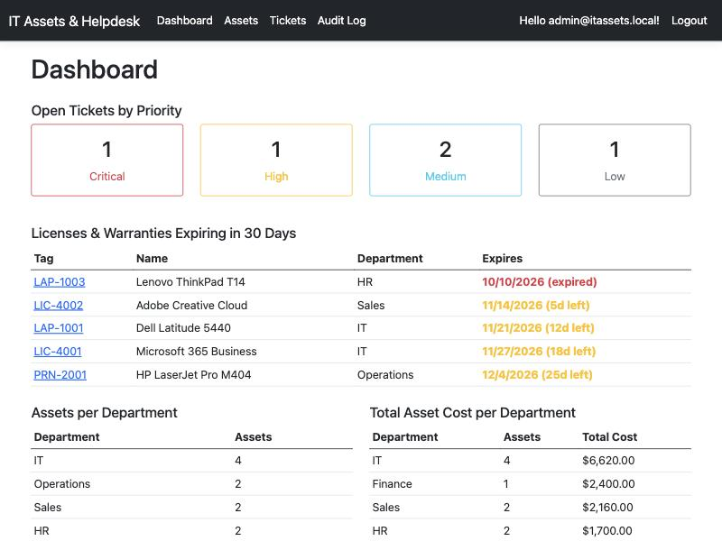
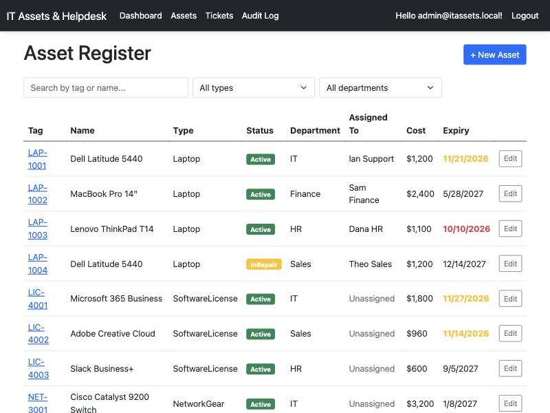
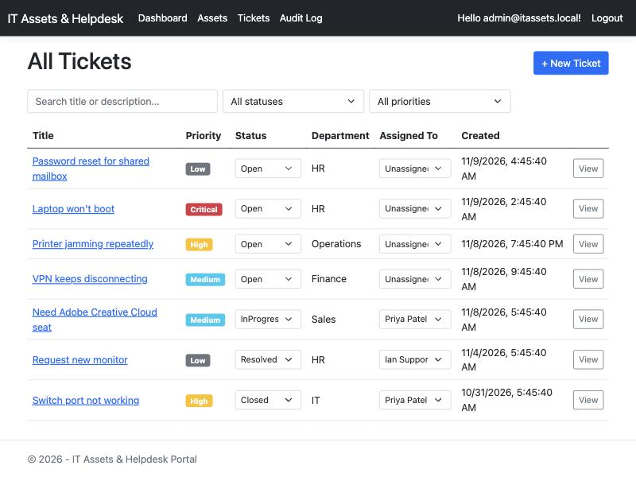
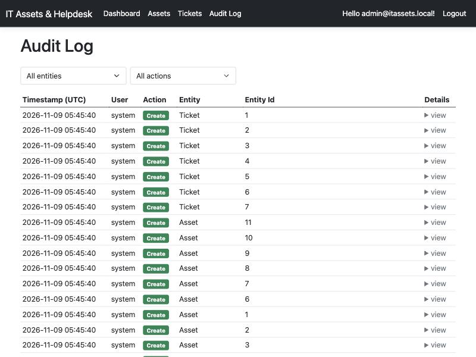

# IT Assets & Helpdesk Portal

A small internal IT portal: an asset register (laptops, printers, network
gear, software licenses), a helpdesk ticket queue, a dashboard, and an audit
trail — built with ASP.NET Core MVC and SQL Server.

| Dashboard | Asset Register |
|---|---|
|  |  |

| Tickets | Audit Log |
|---|---|
|  |  |

## Features

- **Asset register** — laptops, printers, network gear, and software
  licenses, each with department, assignee, purchase cost, and a warranty
  or license expiry date. Live search/filter by tag, name, type, and
  department.
- **Helpdesk tickets** — employees submit requests; IT staff assign,
  reprioritize, and close them inline (no page reload).
- **Dashboard** — open tickets by priority, assets per department, total
  asset cost per department (via a stored procedure), and licenses/
  warranties expiring in the next 30 days.
- **Audit log** — every create, update, and delete is recorded with who
  did it and when; admins can browse and filter it. Deletes are soft
  (an `IsDeleted` flag, hidden by a global query filter), never hard.
- **Roles** — Admin, IT Staff, and Employee each see and can do different
  things (see [Roles](#roles) below).
- **REST API** — `/api/assets` and `/api/tickets`.
- **SOAP endpoint** — `/soap/assets.svc`, via [SoapCore](https://github.com/DigDes/SoapCore).

## Tech stack

ASP.NET Core 8 MVC · EF Core 8 + SQL Server · ASP.NET Core Identity ·
Bootstrap 5 · jQuery/AJAX · SoapCore · xUnit · GitHub Actions

## Roles

| | Admin | IT Staff | Employee |
|---|---|---|---|
| View assets & tickets | ✅ | ✅ | ✅ (own tickets only) |
| Create/edit/delete assets | ✅ | ✅ | ❌ |
| Assign / reprioritize / close tickets | ✅ | ✅ | ❌ |
| Submit a ticket | ✅ | ✅ | ✅ |
| Dashboard financials (cost/department) | ✅ | ✅ | ❌ |
| Audit log | ✅ | ❌ | ❌ |

## Getting started

**Prerequisites:** [.NET 8 SDK](https://dotnet.microsoft.com/download/dotnet/8.0), Docker.

```bash
docker compose up -d
```

```bash
dotnet run --project src/ItAssetsHelpDesk.Web
```

On first run the app applies EF Core migrations and seeds departments,
demo users, sample assets, and sample tickets automatically — nothing else
to set up. Open `http://localhost:5183`.

### Demo accounts

Password for all: `Passw0rd!123`

| Role | Email |
|---|---|
| Admin | admin@itassets.local |
| IT Staff | itstaff1@itassets.local, itstaff2@itassets.local |
| Employee | employee1@itassets.local, employee2@itassets.local, employee3@itassets.local |

### Running tests

```bash
dotnet test
```

## Architecture notes

**Project layout**

```
src/ItAssetsHelpDesk.Web/
  Controllers/        MVC controllers (Assets, Tickets, Dashboard, Admin)
  Controllers/Api/     REST API controllers + DTOs
  Services/            SOAP service (SoapCore) + DTO
  Data/                ApplicationDbContext, migrations, DbSeeder
  Models/               EF entities + enums
  ViewModels/          Form view models
  Views/
tests/ItAssetsHelpDesk.Tests/
```

**Data model.** One `Asset` table covers all four asset types (laptop,
printer, network gear, software license) via a `Type` discriminator column
rather than four separate tables — the fields they need (department,
assignee, cost, an `ExpiryDate` that means "warranty" for hardware and
"license" for software) are the same shape, so one table avoids a lot of
repeated CRUD/view code. `SeatsTotal`/`SeatsUsed` only apply to software
licenses and sit unused for hardware rows — a deliberate trade-off against
splitting the table.

**Audit logging.** `ApplicationDbContext` overrides `SaveChanges`/
`SaveChangesAsync` to inspect the change tracker before saving: entities
of interest (`Asset`, `Ticket`, `Department`, `ApplicationUser`) get an
`AuditLog` row with the acting user, a JSON snapshot of created fields or
just the changed fields on update, and the real database-generated ID
(captured in a second `SaveChanges` pass, since identity values aren't
assigned until after the first one). Identity's own sensitive columns
(`PasswordHash`, `SecurityStamp`, `ConcurrencyStamp`) are explicitly
excluded from what gets logged.

**Soft deletes.** The same override intercepts any entity being deleted
that implements `ISoftDelete`: instead of letting EF issue a `DELETE`, it
flips the entity to `Modified` and sets `IsDeleted = true`. A global query
filter (`HasQueryFilter`) then hides soft-deleted rows from every default
query automatically, so callers don't need to remember to filter them out
— and the audit log records it as a `Delete`, not an `Update`.

**Dashboard / stored procedure.** Three of the four dashboard widgets are
plain LINQ; "total asset cost per department" instead calls a hand-written
SQL Server stored procedure (`dbo.GetAssetCostByDepartment`, created in
the initial migration via `migrationBuilder.Sql(...)`) through
`FromSqlRaw`, mapped to a keyless EF Core type.

**REST API auth.** The API controllers share the same cookie-based
ASP.NET Identity auth as the MVC pages (no separate JWT scheme) — simplest
option for a single first-party app. Cookie auth normally redirects
unauthenticated requests to the login page; `Program.cs` overrides that
for `/api/*` so a plain client gets a `401`/`403` instead of an HTML
redirect. The API endpoints are not behind anti-forgery tokens (only the
server-rendered form posts are) since they're same-site AJAX calls
protected by the cookie's `SameSite=Lax` default — a reasonable
simplification for an internal, single-origin app; a public-facing or
cross-origin version would want token- or header-based CSRF protection
here too.

**Self-registration.** The scaffolded ASP.NET Identity `/Identity/Account/Register`
page is still technically reachable but unlinked from the UI. A
self-registered account has no department and no role, so it can view
nothing and can't submit a ticket — it fails safe rather than silently
granting access. Provisioning real accounts (department + role) is
expected to go through an admin, which matches how most internal
helpdesk tools actually onboard employees; building an in-app "create
user" admin screen was left out to stay inside the time budget.

## REST API

| Method | Path | Notes |
|---|---|---|
| GET | `/api/assets?search=&type=&departmentId=` | List/filter |
| GET | `/api/assets/{id}` | |
| POST | `/api/assets` | Admin/IT Staff |
| PUT | `/api/assets/{id}` | Admin/IT Staff |
| DELETE | `/api/assets/{id}` | Admin/IT Staff — soft delete |
| GET | `/api/tickets?search=&status=&priority=` | Employees see only their own |
| GET | `/api/tickets/{id}` | |
| POST | `/api/tickets` | Any authenticated user |
| PUT | `/api/tickets/{id}` | Admin/IT Staff — status/priority/assignee |
| DELETE | `/api/tickets/{id}` | Admin/IT Staff — soft delete |

## SOAP

```bash
curl -X POST http://localhost:5183/soap/assets.svc \
  -H 'Content-Type: text/xml; charset=utf-8' \
  -H 'SOAPAction: "http://tempuri.org/IAssetSoapService/GetAssetByTag"' \
  -d '<?xml version="1.0" encoding="utf-8"?>
<soap:Envelope xmlns:soap="http://schemas.xmlsoap.org/soap/envelope/" xmlns:tem="http://tempuri.org/">
  <soap:Body>
    <tem:GetAssetByTag><tem:assetTag>LAP-1001</tem:assetTag></tem:GetAssetByTag>
  </soap:Body>
</soap:Envelope>'
```

WSDL is served at `/soap/assets.svc?wsdl`.
